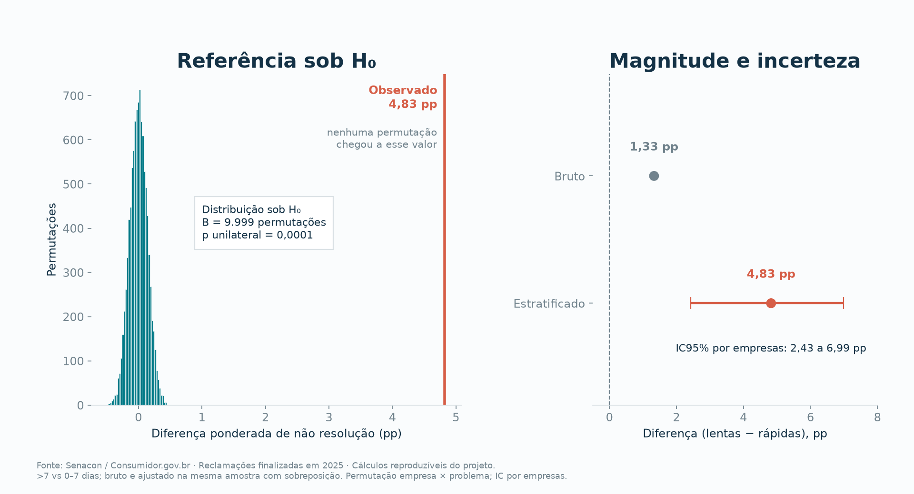
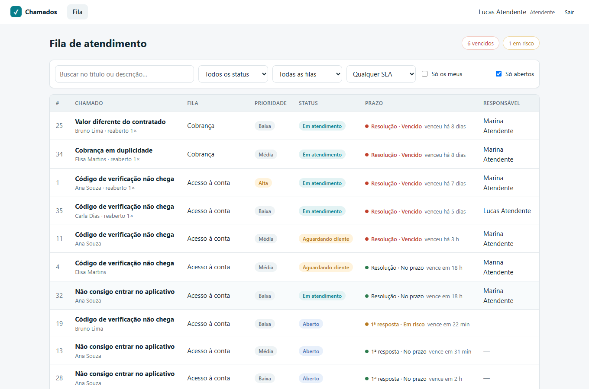

# Atendimento sob evidência

Um sistema de gestão de chamados construído a partir de evidência. Antes de escrever o produto, o projeto mostra com dados públicos que o problema existe e quais requisitos ele exige.

| Etapa | Pasta | Status |
|---|---|---|
| 1. Estudo de caso: a dor existe? | [`analise/`](analise/) | ✅ Concluída |
| 2. Sistema de gestão de chamados | [`sistema/`](sistema/) | ✅ API FastAPI + interface React, 100 testes (unitários, API e ponta a ponta) |

## Etapa 1 — o que os dados mostram

| | |
|---|---|
| **Dados** | 2.328.863 reclamações finalizadas no Consumidor.gov.br em 2025, de 1.740 empresas (fonte oficial) |
| **A dor** | 432.572 reclamações avaliadas como **não resolvidas**, ou 56,2% das avaliadas |
| **H₀** | Dentro de cada empresa × grupo de problema, resolver ou não independe de a resposta passar de 7 dias |
| **H₁** | Respostas acima de 7 dias têm **mais** não resolução (unilateral, α = 5%) |
| **Teste** | Permutação estratificada, com 9.999 embaralhamentos dentro de 4.121 estratos |
| **Resultado** | **+4,83 pp** de não resolução (IC95% de 2,43 a 6,99 pp, por empresas), **p = 0,0001**, H₀ rejeitada |
| **Achado extra** | Respostas em 0–2 dias também falham muito (58,9%): responder não é resolver |



Se H₀ fosse verdadeira, a diferença ficaria entre −0,5 e +0,6 pp. O valor observado foi +4,83 pp. É uma associação observacional, não uma prova de causa. A eficácia do sistema será medida em um piloto.

### 👉 Comece pelo [notebook da análise](analise/notebooks/estudo.ipynb)

Ele roda a análise inteira passo a passo, com o código do teste de permutação, as tabelas e os gráficos gerados com matplotlib. Já vem executado, então os resultados aparecem direto no GitHub.

Também disponíveis: o [estudo de caso visual](analise/reports/estudo_de_caso.html), o [relatório completo](analise/reports/relatorio.md) e a [documentação técnica](analise/README.md), com a arquitetura e os testes.

## Etapa 2 — o sistema



O sistema transforma cada evidência da análise numa regra de negócio, como mostra a tabela abaixo. E o ciclo se fecha: os chamados do sistema podem ser exportados e analisados com o mesmo teste de permutação da Etapa 1 (`python -m atendimento piloto`). Os detalhes, as instruções para executar e mais telas estão em [`sistema/README.md`](sistema/README.md).

## Da evidência aos requisitos

| Evidência | Requisito do sistema |
|---|---|
| +4,83 pp de não resolução acima de 7 dias | Prazos (SLA) configuráveis por fila, com alerta antes do vencimento |
| Respostas muito rápidas também falham | Separar “respondido” de “solução confirmada pelo cliente” |
| 77,7% já tinham procurado a empresa antes | Histórico único de interações por cliente |
| Desempenho varia por empresa e tipo de problema | Triagem por categoria e atribuição de responsável |
| 67% dos casos ficam sem avaliação | Pesquisa de satisfação no encerramento |

## Estrutura do repositório

```
projeto/
├── README.md        visão geral (este arquivo)
├── analise/         Etapa 1: pacote Python, testes, dados, figuras e relatórios
└── sistema/         Etapa 2: gestão de chamados
    ├── backend/     API FastAPI: domínio, serviços, rotas, migrações e testes
    └── frontend/    interface React + TypeScript
.github/workflows/   CI: análise, backend, frontend e testes de ponta a ponta a cada push
```
