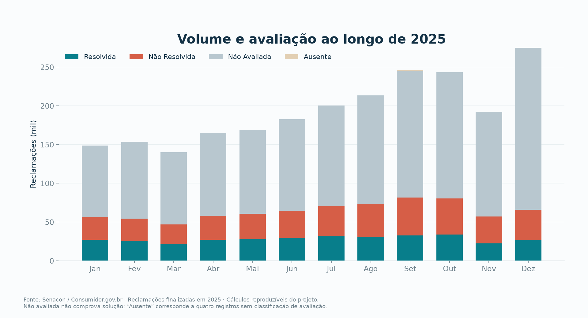
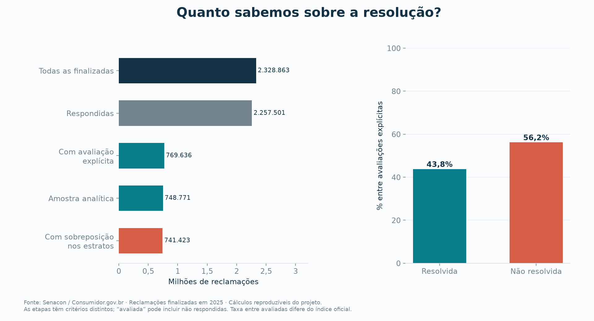
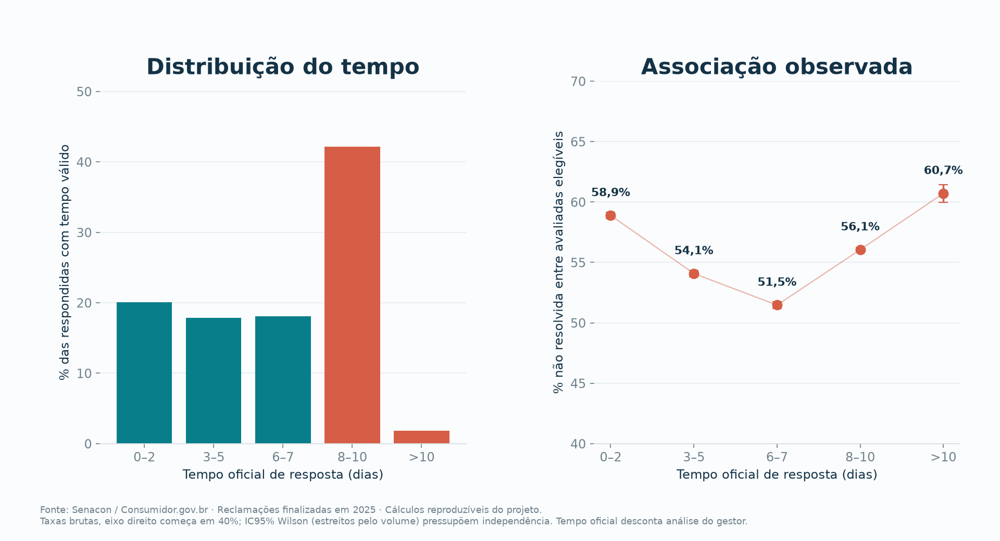
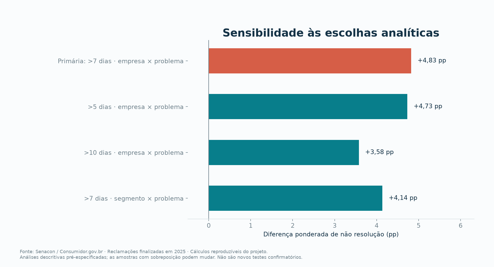
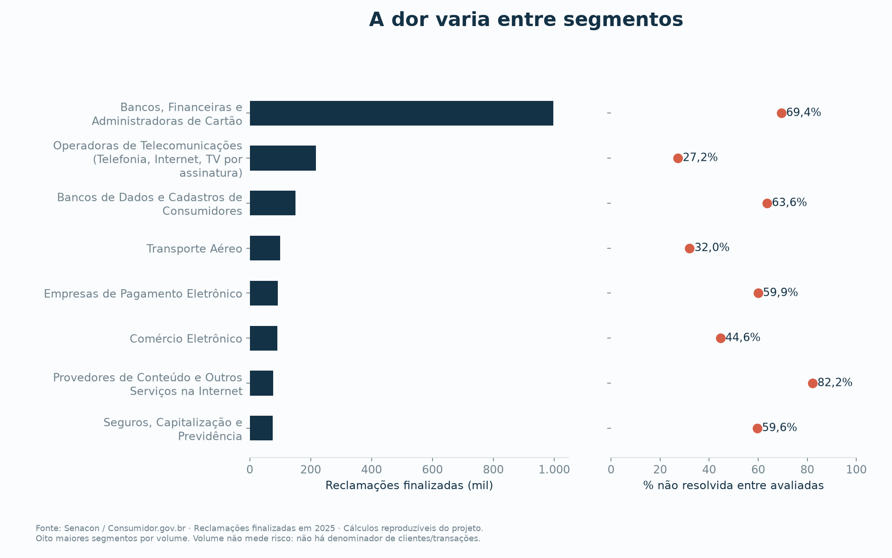

# Dados orientam um atendimento mais rastreável

**Estudo de caso · Consumidor.gov.br · Finalizadas em 2025 · Análise de 18/10/2026**

Os dados documentam um problema concreto: **432.572 reclamações foram declaradas não resolvidas**, equivalentes a **56,20% das 769.636 avaliações explícitas**. Dentro de grupos de uma mesma empresa e categoria de problema, respostas acima de sete dias apresentaram **4,83 pontos percentuais a mais de não resolução**, em média ponderada. Um teste unilateral com **9.999 permutações** produziu **p = 0,0001**, sob as suposições descritas adiante. Isso sustenta a hipótese alternativa de associação entre maior tempo de resposta e pior desfecho nessa população. A base é observacional e a avaliação cobre apenas **33,05%** das reclamações finalizadas; portanto, o resultado não demonstra que um novo software seja necessário, nem que ele melhorará os desfechos. A decisão informada por este estudo é investigar um sistema que registre responsáveis, prazos e solução confirmada, e avaliar sua eficácia em um piloto posterior. Os resultados são cálculos deste projeto sobre a [fonte oficial](https://www.consumidor.gov.br/pages/dadosabertos/externo/) e podem ser auditados nas [métricas completas](metrics.json).

## 1. O volume revela a dor; a avaliação define seu alcance

Foram utilizados os **12 arquivos oficiais de reclamações finalizadas entre janeiro e dezembro de 2025**, somando **2.328.863 registros**, **1.740 empresas** e **45 segmentos**. O período se refere à finalização, e não à abertura da reclamação. A plataforma recebe conflitos de consumo e não reúne todos os atendimentos das empresas. Além disso, **77,67%** dos registros indicam que o consumidor procurou a empresa anteriormente; isso não identifica o processo ou software utilizado. A finalidade e o funcionamento do canal são descritos na [FAQ institucional](https://consumidor.gov.br/pages/conteudo/publico/1); as URLs e os hashes dos arquivos usados constam no [manifesto da coleta](../data/manifest.json).

O gráfico mostra fluxo de finalizações e cobertura de avaliação ao longo do ano. Aumento de volume não equivale, sozinho, a deterioração do atendimento: faltam denominadores como clientes ativos, transações e total de contatos. Tampouco permite medir crescimento de mercado para um novo sistema.

| Indicador | Quantidade | Denominador e leitura |
|---|---:|---|
| Finalizadas no período | 2.328.863 | Universo dos arquivos selecionados |
| Respondidas | 2.257.501 | 96,94% das finalizadas |
| Não respondidas | 71.362 | 3,06% das finalizadas |
| Avaliadas explicitamente | 769.636 | 33,05% das finalizadas |
| Declaradas não resolvidas | 432.572 | 56,20% das avaliadas explicitamente |
| Declaradas resolvidas | 337.064 | 43,80% das avaliadas explicitamente |
| Categoria “Não Avaliada” | 1.559.223 | Sem desfecho explícito; outras 4 avaliações estão em branco |

**Responder e resolver são métricas diferentes.** Os recortes do gráfico não formam um funil estritamente sequencial: há **20.865 reclamações avaliadas sem resposta**, excluídas da comparação de tempo. As **1.559.227 reclamações sem avaliação explícita**, incluindo os quatro campos em branco, não foram convertidas em sucesso ou fracasso. A taxa de resolução entre avaliadas deste estudo difere do índice oficial, cuja definição inclui não avaliadas no numerador. Não se deve apresentar 43,80% como o índice oficial de solução da plataforma. ([Metodologia oficial dos indicadores](https://www.consumidor.gov.br/pages/indicador/geral/abrir), [resultados calculados](metrics.json)).

## 2. A hipótese compara tempo de resposta e não resolução

A pergunta estatística é: **entre reclamações respondidas e avaliadas, respostas acima de sete dias estão associadas a maior proporção de não resolução, comparando casos dentro da mesma empresa e grupo de problema?** O [plano de análise](../docs/plano_analise.md) registrou esse contraste, a direção do teste e o nível de significância antes de tabular os resultados, após inspecionar o cabeçalho da fonte. É um registro local, não um pré-registro público independente.

| Elemento | Definição |
|---|---|
| H0 — hipótese nula | Dentro de cada estrato empresa × grupo de problema, os rótulos de resolução são permutáveis entre as faixas de tempo, sem associação com a faixa. |
| H1 — hipótese alternativa | A diferença ponderada da proporção não resolvida é positiva para respostas acima de 7 dias, em comparação com respostas de 0 a 7 dias. |
| Desfecho | Avaliação explícita “Não Resolvida”, binária. |
| Estatística | Média ponderada das diferenças de proporção dentro dos estratos, com peso igual ao número de reclamações do estrato. |
| Regra de decisão | Teste unilateral, alfa = 5%; rejeitar H0 se p ≤ 0,05, sob as suposições do teste. |

O corte de **sete dias é analítico**, escolhido como referência de uma semana; não é um SLA legal, contratual ou oficial comprovado. O campo utilizado é o **tempo oficial de resposta**, que desconta o período de análise pelo gestor segundo o dicionário institucional. Ele não equivale necessariamente ao tempo corrido total nem ao tempo até solução. Entre as respondidas, sua média foi **6,21 dias**, a mediana **7 dias** e o percentil 90 **10 dias**. ([Dicionário institucional da ANAC](https://www.anac.gov.br/acesso-a-informacao/dados-abertos/areas-de-atuacao/voos-e-operacoes-aereas/dados-do-consumidor-gov/52-dados-do-consumidor-gov), [métricas](metrics.json)).

O painel de desfecho é descritivo e utiliza **748.771 reclamações respondidas, avaliadas explicitamente e com tempo válido**. As barras de incerteza por faixa são intervalos de Wilson com independência individual presumida; não são os intervalos por empresa do resultado principal. Antes de estratificar, a não resolução foi **54,96%** nas respostas de até sete dias (**231.552/421.276**) e **56,30%** nas acima de sete dias (**184.364/327.495**), diferença bruta de **1,33 ponto percentual**. A relação bruta não é monotônica: a não resolução é **58,89%** em 0–2 dias, cai a **51,47%** em 6–7 dias e sobe a **60,71%** acima de 10 dias. Respostas muito rápidas também falham com frequência, o que é compatível com respostas padronizadas que encerram o caso sem tratá-lo, e reforça que “responder” e “resolver” devem ser medidos separadamente. As faixas podem reunir empresas e problemas diferentes; por isso, o teste principal compara as duas faixas dentro de cada estrato. ([Métricas](metrics.json), [agregados por faixa](../data/processed/response_bands.csv)).

Dos **6.542 estratos** possíveis na amostra analítica, **4.121** contêm observações nas duas faixas. O contraste principal usa **741.423 reclamações de 1.054 empresas**, cobrindo **99,02% da amostra analítica**. Foram excluídas **7.348 reclamações** em estratos sem comparação interna possível. A inferência se refere a esse recorte; não recupera o desfecho das pessoas que não avaliaram. ([Métricas e exclusões](metrics.json)).

## 3. A permutação separa associação observada do acaso de referência

Imagine manter fixos, em cada empresa e grupo de problema, os tempos de resposta e a quantidade total de reclamações não resolvidas. Sob H0, embaralhamos os rótulos “resolvida” e “não resolvida” entre os casos desse estrato e recalculamos a diferença. Repetimos esse procedimento **9.999 vezes**, sempre dentro dos mesmos estratos. Assim obtemos a distribuição de resultados esperados nesse mecanismo de ausência de associação. O algoritmo sorteia contagens hipergeométricas, equivalentes a embaralhar os rótulos de uma tabela binária com margens fixas; a simulação completa do teste é Monte Carlo, não enumeração exaustiva. ([Implementação](../atendimento/stats.py), [documentação metodológica do SciPy](https://docs.scipy.org/doc/scipy/reference/generated/scipy.stats.permutation_test.html)).

**Estatística:** `T = Σs (ns / N) × (p_acima7,s − p_ate7,s)`. Cada `ns` é o número de reclamações do estrato, `N = 741.423` e cada `p` é sua proporção não resolvida. Multiplicar `T` por 100 expressa a diferença em pontos percentuais. Os pesos permanecem fixos em todas as permutações.

O resultado foi **+4,83 pontos percentuais**, com **IC95% de +2,43 a +6,99 pontos percentuais**, calculado por **4.999 reamostragens de empresas inteiras**. A magnitude representa aproximadamente **4,8 casos adicionais não resolvidos a cada 100 casos comparados**, na média ponderada dos estratos. Não representa casos que o software evitará. O contraste bruto na figura utiliza a mesma amostra com sobreposição para permitir comparação de composição; já os 1,33 ponto percentual apresentados anteriormente usam toda a amostra analítica. Ajustar por empresa e problema muda os pesos e as comparações, sem transformar o estudo em causal. ([Resultados completos](metrics.json)).

**Nenhuma das 9.999 permutações** gerou estatística igual ou superior à observada. Aplicando a correção de Monte Carlo, `p = (b + 1) / (B + 1) = (0 + 1) / (9.999 + 1) = 0,0001`. Este é o menor p-valor reportável com esse número de sorteios; não significa p = 0 nem uma probabilidade de 99,99% de H1 ser verdadeira. A distribuição nula teve desvio-padrão de **0,140 ponto percentual** e variou de **−0,476 a +0,615**, enquanto o efeito observado foi +4,83. **Rejeitamos H0 a 5% sob o modelo de permutabilidade**, com evidência favorável à H1 operacional. A decisão também considera a magnitude e os limites do desenho, conforme a orientação da [ASA sobre p-valores](https://www.amstat.org/asa/files/pdfs/p-valuestatement.pdf) e a [correção de Phipson e Smyth](https://pubmed.ncbi.nlm.nih.gov/21044043/).

O intervalo por empresas descreve estabilidade quando a composição de empresas muda por reamostragem; não é um intervalo de representatividade nacional. O teste permuta rótulos dentro dos estratos, enquanto o intervalo reamostra empresas inteiras: **são mecanismos de incerteza distintos**, e não uma inversão exata do mesmo teste. As sementes são **20251018** para a permutação e **20251019** para o bootstrap. ([Plano](../docs/plano_analise.md), [código](../atendimento/stats.py)).

As sensibilidades previamente definidas preservaram a direção: **+4,73 pontos percentuais** com corte acima de cinco dias; **+3,58** com corte acima de dez; e **+4,14** ao estratificar por segmento × grupo de problema, mantendo sete dias. São comparações descritivas de robustez, sem novos testes confirmatórios ou seleção do menor p. As amostras mudam: o corte de dez dias preserva **79,63%** da amostra analítica, contra **99,02%** no principal; a diferença entre efeitos não pode ser atribuída exclusivamente ao corte. Se esses contrastes fossem tratados como uma família confirmatória, seria necessário um plano de multiplicidade, como Holm. ([Sensibilidades reproduzíveis](../data/processed/sensitivity.csv)).

## 4. A evidência orienta requisitos, com limites explícitos

O suporte estatístico depende de **permutabilidade dentro de empresa × problema**, que não foi garantida por randomização. Casos mais complexos podem simultaneamente demorar e permanecer sem solução. Mudanças ao longo do ano, consumidores recorrentes e outras dependências não medidas também podem influenciar o resultado. O mês de finalização não foi tratado como confusor porque ocorre depois do processo de resposta, e a data de abertura não estava disponível no esquema utilizado. Bloquear permutações por empresa e problema não remove automaticamente essas dependências. ([Winkler et al., estudo metodológico original](https://pmc.ncbi.nlm.nih.gov/articles/PMC4010955/), [plano e limitações](../docs/plano_analise.md)).

Há duas seleções relevantes: decidir reclamar nesta plataforma e decidir avaliar. A cobertura de avaliação nas respondidas foi **33,32%** para até sete dias e **32,98%** para acima de sete; a proximidade não demonstra ausência de viés de seleção. A base não informa adoção de software, custo por chamado ou tamanho da clientela. Portanto, **não estimamos demanda comercial, retorno financeiro ou eficácia do produto**. ([Métricas](metrics.json), [funcionamento do canal](https://consumidor.gov.br/pages/conteudo/publico/1)).

A composição por segmento ajuda a escolher um contexto para entrevistas e prototipagem. Quantidade de reclamações não é ranking de qualidade: faltam clientes e transações no denominador. Percentuais entre avaliadas devem ser lidos junto à cobertura e à seleção já descritas. ([Agregados setoriais](../data/processed/segments.csv)).

| Evidência ou lacuna observada | Hipótese funcional para o sistema | Como validar depois |
|---|---|---|
| Associação entre tempo de resposta e não resolução | Fila com prazos configuráveis e alertas ajuda a priorizar casos | Proporção respondida no prazo e percentil 90, com regra definida no piloto |
| 432.572 avaliações indicam não resolução | Separar “resposta enviada” de “solução confirmada” melhora acompanhamento | Resolução confirmada em janela fixa e taxa de reabertura |
| 77,67% relatam contato anterior | Histórico de interações reduz repetição de contexto | Recontatos e tempo de tratamento, com auditoria de qualidade |
| Empresas e grupos de problema têm composições distintas | Triagem por categoria e encaminhamento reduzem transferências inadequadas | Tempo até atribuição e reclassificações |
| 66,95% não têm avaliação explícita | Registrar avaliação ausente e coletar feedback torna indicadores interpretáveis | Cobertura de avaliação e diferenças entre respondentes e demais casos |
| Responsável e transferências não são observados nesta base | Atribuição explícita e trilha de auditoria ajudam a identificar casos sem acompanhamento | Tempo sem responsável e número de transferências; hipótese a investigar |

Essa matriz propõe mecanismos a testar. Não afirma que a ausência de funcionalidades causou os resultados. O fluxo institucional de acompanhar, interagir e avaliar é uma referência de processo, descrita nos [Termos de Uso da plataforma](https://consumidor.gov.br/pages/conteudo/publico/7).

## 5. O próximo passo é um piloto que meça eficácia

Antes da implementação, entrevistas com gestores e atendentes devem confirmar o gargalo, o processo atual, os custos e as alternativas já disponíveis. A hipótese de produto será: **atribuir o novo sistema melhora um desfecho operacional relevante**, definido antes de observar o piloto. Uma escolha possível é a proporção de chamados com resposta dentro de um prazo pactuado, acompanhada de resolução confirmada, reabertura, satisfação, custo e sobrecarga para evitar premiar apenas velocidade.

Se houver equipes ou filas comparáveis em número suficiente, a proposta é **randomizar a adoção do sistema por equipe ou fila**, com blocos de perfil e volume. A H0 será ausência de efeito da atribuição ao sistema; a H1, melhora no desfecho primário. A permutação deverá respeitar a unidade e os blocos da randomização, e o dimensionamento considerar correlação entre chamados da mesma equipe. O menor ganho útil, duração, tratamento dos chamados em aberto e critérios de sucesso precisam ser definidos com a empresa. Um antes/depois simples não isolaria sazonalidade e outras mudanças. Este piloto é uma proposta; **o sistema não foi implementado nem testado nesta etapa**.

O valor deste projeto de portfólio está em conectar dados verificáveis, inferência e decisões de produto. Há uma dor documentada e uma associação operacional consistente que justificam aprofundar a investigação. A conclusão comercial permanece aberta: demonstrar que a solução merece adoção exige observar o processo real e comparar o benefício com seu custo.

### Auditoria e reprodução

Os arquivos brutos são obtidos da [página oficial de dados abertos](https://www.consumidor.gov.br/pages/dadosabertos/externo/) e identificados pelo [manifesto com URLs e SHA-256](../data/manifest.json). O pipeline valida os hashes, datas, meses, categorias e tempos; preserva registros com atributos iguais porque o esquema não tem identificador único que permita afirmar duplicação. Os resultados versionáveis contêm agregados, sem publicar microdados ou narrativas individuais. A licença dos dados deve ser confirmada na fonte antes de sua redistribuição.

O [README](../README.md) contém a instalação e a execução. O [pacote de análise](../atendimento/), o [notebook](../notebooks/estudo.ipynb), os [testes estatísticos](../tests/test_statistics.py), a [auditoria independente](../tests/test_auditoria.py), as [métricas JSON](metrics.json) e a [distribuição nula completa](../data/processed/permutation_null.csv) permitem examinar e reproduzir o resultado. A [versão HTML deste estudo](estudo_de_caso.html) utiliza as mesmas figuras locais. No PowerShell, a partir da pasta `analise/`, abra-a com `Start-Process .\reports\estudo_de_caso.html`.
